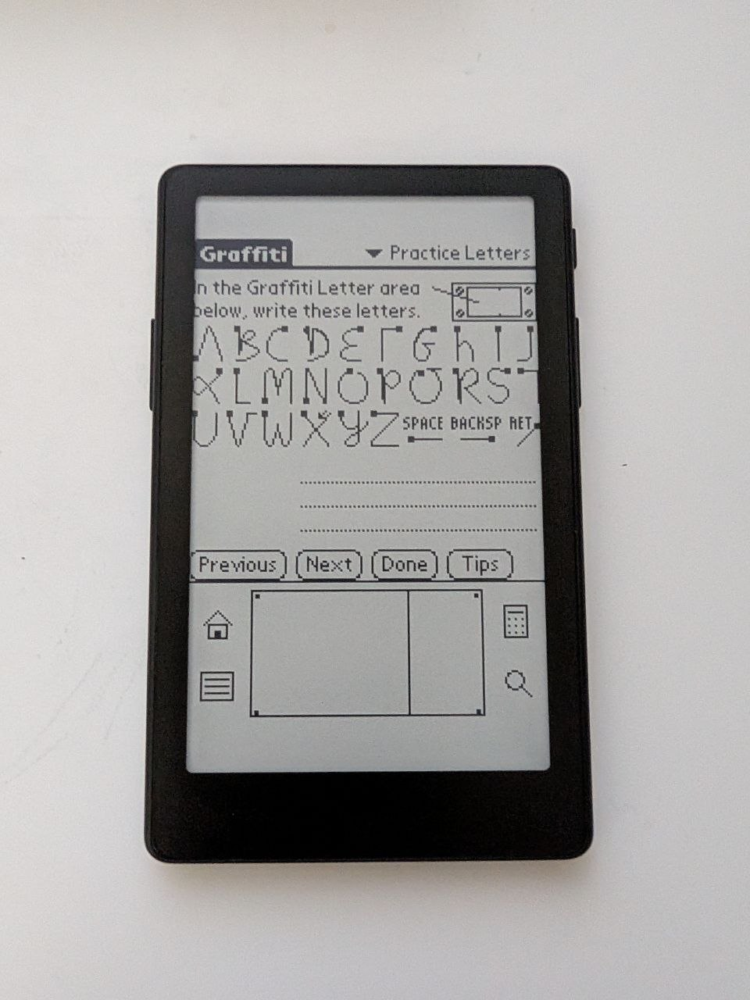
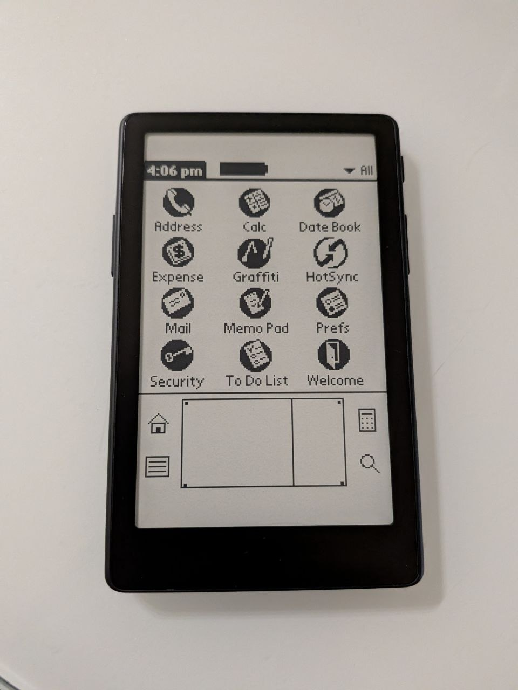

# Dragonfruit (Xteink X4 Pro Fork)

> **Note:** This fork of Dragonfruit is specifically ported and configured for the **Xteink X4 Pro** (ESP32-S3, 4.3" 800×480 e-ink panel). The original upstream project targeted the M5Paper (classic ESP32).

An emulator of the Motorola MC68EZ328 ("DragonBall EZ"), the 68000-based
system-on-chip at the heart of the late-90s Palm handhelds, with enough of the surrounding
machine modeled to boot stock Palm OS 3.x and run it. Everything is written from scratch in
portable C: a 68000 interpreter plus models of the DragonBall's on-chip peripherals
(interrupt controller, timer, RTC, GPIO, SPI, UART, LCD controller).

The core has no platform dependencies. It runs headless on a PC for development and on ESP32
hardware for the real thing. This fork targets the **Xteink X4 Pro**, an ESP32-S3 e-reader
with an 800×480 e-ink panel and a capacitive touchscreen, turning it into a working Palm IIIx:
it boots to the launcher, runs the first-boot setup wizard, and takes stylus/finger input
including Graffiti handwriting.

You supply the ROM. Palm OS is copyrighted and is not included here; see [Running it](#running-it).



## What works

- Boots Palm OS 3.1 from a stock Palm IIIx ROM, all the way to the launcher, on both the PC
  host and the device.
- First-boot setup wizard: welcome, digitizer calibration, country / time / date.
- Stylus input: taps, the silkscreen buttons (Apps / Menu / Calc / Find), and Graffiti
  handwriting, all over one continuous digitizer surface that the ROM handles natively.
- Real-time clock and 100 Hz system tick driven by wall-clock time, so both stay correct
  regardless of emulation speed.
- Sleep and auto-off (the DragonBall's PLL-off `STOP` mode) with power-key wake through the
  modeled keyboard matrix. On the M5Paper this also drives the ESP32 into light sleep.
- Installs `.prc` / `.pdb` / `.pqa` files from the SD card into emulated RAM, and backs up or
  restores the device's databases to the card.
- Optional configurable on-screen layout: relocate or resize the silkscreen, rotate to
  landscape, or magnify, all from a file on the SD card.

## Portability

The project is the emulator, not any single board. The split is deliberate:

- **Core, portable C.** The 68000 interpreter, the DragonBall peripheral models, the bus, and
  the Palm OS integration (pen injection, the installer, backup/restore) carry no ESP-IDF or
  board dependencies. The PC host build compiles exactly this code with a thin shim standing
  in for ESP-IDF, which is what makes day-to-day work possible without flashing hardware.
- **Performance backend, per-ISA.** On device the hot path is a burst JIT that translates
  68000 blocks to native code. Its code generator sits behind a backend interface selected at
  build time, so a new instruction set is a new backend rather than a rewrite. The classic
  ESP32 (Xtensa) backend is complete; an ESP32-P4 (RISC-V) build links and runs
  interpreter-only while its backend is still to be written.
- **Board, peripherals.** The e-ink driver, touch controller, SD mount, and battery sensing
  live in their own components. Bringing up a different ESP32 board is a matter of writing
  those drivers, not touching the core.

On the ESP32 side the requirements are external PSRAM (the 2 MB of emulated RAM and the ROM
image live there) and two cores (the JIT's compiler runs on the second one). That rules out
single-core, no-PSRAM parts such as the ESP32-C3.

## Hardware (Xteink X4 Pro target)

- **SoC** — ESP32-S3, dual-core Xtensa LX7 @ 240 MHz, 16 MB QIO flash, 8 MB Octal PSRAM (80 MHz), native USB Serial/JTAG console.
- **Display** — 4.3" 800×480 e-ink panel over SPI (`epd_x4pro.c`), with runtime auto-detection across X4 Pro panel controller variants (UC8279, UC8179, and SSD1677). The Palm's 160×160 1bpp framebuffer is scaled and rotated into a portrait layout with the Graffiti silkscreen rendered below it.
- **Touch** — GT911 capacitive controller over I²C (SDA=GPIO39, SCL=GPIO38, INT=GPIO10, RST=GPIO4, PWR=GPIO2).
- **Buttons & Power** — Up (`GPIO0`), Power (`GPIO3`), and Down (`GPIO7`) buttons, battery power latch (`GPIO1`), and CW2017 I²C battery fuel gauge (`0x63`).
- **Storage** — microSD over 1-bit SDMMC (`CLK=GPIO41`, `CMD=GPIO42`, `D0=GPIO40`) with active-low card power switch (`GPIO5`).

*(Original M5Paper classic ESP32 / IT8951 drivers remain in the tree when building for `esp32`.)*

## Repository layout

```
src/
  main/             ESP-IDF entry point and the FreeRTOS tasks (CPU, display, input, battery)
  components/
    m68k/           68000 interpreter (decode, addressing, ALU, move, branch, shift, bit,
                    BCD, system) plus the device-only burst JIT and its per-ISA backend
    bus/            24-bit address space: 2 MB RAM, the ROM window, peripheral decode
    dragonball/     MC68EZ328 peripherals: interrupt controller, timer, RTC, GPIO,
                    SPI (digitizer + battery ADC), UART, LCD controller
    display/        E-ink driver (epd_x4pro.c for X4 Pro / it8951.c for M5Paper); composites
                    the framebuffer and silkscreen overlay
    input/          GT911 touch polling into a pen-event queue; button latches; CW2017 gauge
    layout/         Panel-to-Palm coordinate mapping, shared by display and input
    config/         Reads the optional layout config off the SD card at boot
    rom_loader/     Loads the ROM from the SD card into PSRAM at boot
    installer/      Installs PRC/PDB/PQA into RAM; backs up and restores databases
    m5_sd/          microSD mount (1-bit SDMMC on X4 Pro, shared SPI on M5Paper)
  host/             PC build harness: runs the core headless, with esp_shim.h in place of
                    ESP-IDF and a PNG snapshotter (plus an optional SDL window) for the screen
tools/              Host-side scripts that drive the on-device serial debug console
reference/          Read-only reference emulators and datasheets, consulted for hardware
                    behavior and never copied (not committed; see below)
```

`reference/` holds third-party emulators (CloudpilotEmu, Mu, POSE) and vendor driver examples
used only to understand how the hardware behaves. It is not part of this repository's source
and is not committed.

## Running it

You need a Palm OS 3.x ROM for the Palm IIIx. It is not distributed here. The usual source is
to transfer it off a device you own (the classic Palm OS Emulator shipped a ROM-transfer tool
for exactly that).

### On a PC, no hardware

The fastest way to iterate. The host build compiles the same emulator core and writes a PNG
whenever the screen changes.

```
cmake -S src/host -B build-host
cmake --build build-host
./build-host/dragonfruit -r Palm-IIIx-3.1.rom -c 150000000
```

`-r` selects the ROM, `-c` caps the cycle count, `-i <file>` queues a PRC/PDB to auto-install,
and `-b <dir>` exports the RAM databases on exit. For an interactive window (the emulated
screen and silkscreen, with mouse clicks passed through as pen taps), build with the SDL UI
and run with `--ui`:

```
cmake -S src/host -B build-host -DHOST_UI=ON
cmake --build build-host
./build-host/dragonfruit -r Palm-IIIx-3.1.rom --ui
```

### On the Xteink X4 Pro

You can build the firmware either manually with a local ESP-IDF installation or inside the reproducible Docker container.

#### Option 1: Manual compilation (ESP-IDF CLI)

1. Install **ESP-IDF** (v5.x or v6.0 recommended) with ESP32-S3 toolchain support, and activate the environment in your shell:

   ```bash
   # Adjust path to your ESP-IDF installation
   . $HOME/esp/esp-idf/export.sh
   ```

2. Configure the target for `esp32s3` and build:

   ```bash
   # Only needed on a fresh checkout or after fullclean (recreate sdkconfig from sdkconfig.defaults):
   idf.py set-target esp32s3

   # Compile the firmware:
   idf.py build
   ```

   This produces the build artifacts under `build/`:
   - `build/bootloader/bootloader.bin` (offset `0x0`)
   - `build/partition_table/partition-table.bin` (offset `0x8000`)
   - `build/dragonfruit.bin` (offset `0x10000`)

3. **(Optional) Create a single merged binary** (e.g. for web flashers or full-image backups):

   ```bash
   esptool.py --chip esp32s3 merge_bin \
     -o dragonfruit-x4pro-merged.bin \
     --flash_mode dio --flash_freq 80m --flash_size 16MB \
     0x0 build/bootloader/bootloader.bin \
     0x8000 build/partition_table/partition-table.bin \
     0x10000 build/dragonfruit.bin
   ```

4. **Flash and monitor** over USB-C (replace `/dev/ttyACM0` with your serial port, e.g. `/dev/ttyUSB0` or `COM5`):

   ```bash
   # Using idf.py:
   idf.py -p /dev/ttyACM0 flash monitor

   # Or directly with esptool:
   python -m esptool --chip esp32s3 --port /dev/ttyACM0 --baud 460800 \
     write-flash --flash-mode dio --flash-size 16MB --flash-freq 80m \
     0x0 build/bootloader/bootloader.bin \
     0x8000 build/partition_table/partition-table.bin \
     0x10000 build/dragonfruit.bin
   ```

#### Option 2: Docker container build

If you prefer not to install ESP-IDF locally, you can build inside the containerized toolchain (`espressif/idf:release-v6.0`):

```bash
# Linux / macOS:
docker compose run --rm idf idf.py build

# Windows PowerShell helper:
./build.ps1                       # idf.py build inside the container (subcommands pass through)
```

#### Preparing the SD card

The ROM is not embedded in the firmware. Copy a Palm IIIx ROM to a FAT32 microSD card as
`palm.rom` and insert it before powering on. At boot the firmware powers on the SD slot, mounts
the card over 1-bit SDMMC, reads the ROM into PSRAM, then unmounts. If the card or file is
missing or invalid, the device prints the reason on the e-ink panel and halts.

#### What goes on the SD card

The firmware reads everything from the card's root. Only `palm.rom` is required; the rest are
optional and can be added later.

```
palm.rom         (required)  The Palm IIIx ROM image, read into PSRAM at boot.
palm.cfg         (optional)  On-screen layout (relocate/rotate/magnify the silkscreen) plus
                             serial-bridge settings.
digitizer.cfg    (optional)  Touch-sensitivity tuning. If absent, the firmware writes one
                             from the panel's current values on first boot, ready to edit.
install/         (optional)  A directory of .prc / .pdb / .pqa files installed into RAM at
                             every boot. Files are left in place; emulated RAM is volatile,
                             so they reinstall on each cold start.
backup/          (optional)  Destination for database backups. Hold the UP side button for a
                             second to back up here; hold DOWN to restore.
```

To customize the layout, copy [`palm.cfg.example`](palm.cfg.example) to the card as `palm.cfg`
and edit it.

Requirements: Docker Desktop, and on the host Python with `esptool` and `pyserial`
(`pip install esptool pyserial`).

## How it works

1. **CPU.** A switch-dispatched 68000 interpreter executes the ROM, handling vectored
   interrupts and the `STOP` instruction used for sleep.
2. **Bus.** A 24-bit address space: 2 MB RAM at `0x0`, the ROM window at `0x10C08000`, and the
   DragonBall register block at `0xFFFFF000`, with the hot read/write paths inlined.
3. **Peripherals.** The DragonBall model drives the interrupt controller, the 100 Hz timer,
   the RTC (from wall-clock time), GPIO, the SPI master (both the digitizer and the battery
   ADC), the UART, and the LCD controller that publishes the framebuffer address.
4. **Display and input.** The 1bpp framebuffer is composited with the silkscreen and blitted
   to the panel. Touch points are not injected through the digitizer hardware — that path
   fatal-errors on the IIIx — but enqueued through the ROM's `EvtEnqueuePenPoint` syscall, the
   same device-independent route other Palm emulators take.
5. **JIT (device).** Hot ROM blocks are compiled to native code on the second core and cached
   in executable memory; cold code runs an inlined-interpreter burst. Only ROM is compiled, so
   there is no self-modifying-code invalidation to handle.

## Performance

The pure interpreter runs the 68000 at roughly 8 MHz, about 58% of the real IIIx's 16.58 MHz,
and is compute-bound on per-instruction work. The burst JIT brings a settled screen to around
87% of real time. The remaining gap is cold operating-system code that runs too few times to
be worth compiling and stays at the interpreter floor; closing it is a cold-path problem, not
a matter of more JIT tuning. The JIT is on by default and can be disabled to fall back to the
interpreter.

## License

MIT. See [LICENSE](LICENSE).


